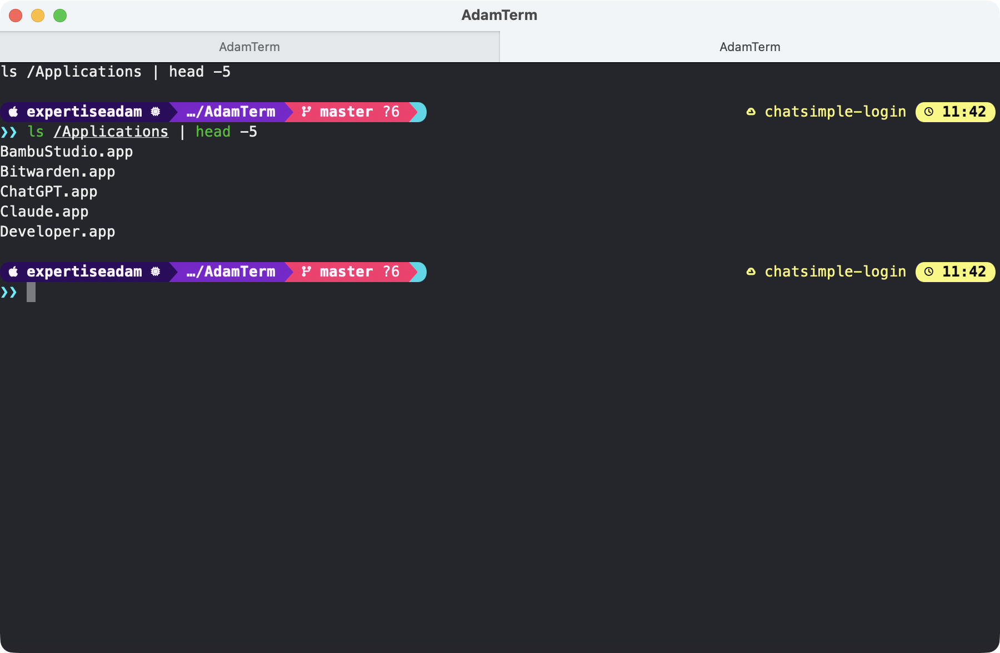

# AdamTerm

I was messing around with [REA](https://github.com/morluto/rea) and wanted to see what it could do, so I pointed it at Ghostty and had it rebuild the shell as a tiny terminal of my own.

A minimal macOS terminal built by reverse-engineering Ghostty 1.3.1 with REA
(Reverse Engineer Anything, an MCP toolkit that inspects shipped binaries) and
rebuilding its native shell around SwiftTerm (a Swift terminal-emulator library).



## Build and run

```bash
./build.sh --run        # builds dist/AdamTerm.app and opens it
```

Self-check (types a command, opens a tab, writes a window screenshot, exits 0):

```bash
ADAMTERM_SCREENSHOT=/tmp/adamterm.png ./dist/AdamTerm.app/Contents/MacOS/AdamTerm
```

Shortcuts: ⌘N new window, ⌘T new tab, ⌘W close, ⌘+/⌘-/⌘0 font size, ⌘⇧{ } switch tabs, ⌘F full screen.

## What REA found in Ghostty.app (no Hopper/Ghidra needed)

Commands run: `rea inspect-macho`, `inspect-plist`, `inspect-signature`,
`inspect-native-dispatch-metadata`, `decode-interface-builder`, `trace-dylib-resolution`.

| Evidence | Finding |
| --- | --- |
| Mach-O exports: 84 `ghostty_*` C symbols (`ghostty_app_new`, `ghostty_surface_new`, `ghostty_surface_key`, `ghostty_surface_mouse_button`, `ghostty_surface_split`, ...) | The terminal core is a C API ("libghostty", written in Zig) statically linked into one 21 MB arm64 binary. The Swift shell only talks to it through these calls. |
| Linked frameworks: AppKit, SwiftUI, Metal, MetalKit, CoreText, Carbon, Sparkle | AppKit windows and menus, SwiftUI for small panels, Metal for cell rendering, Sparkle for updates. |
| Objective-C runtime metadata: 146 classes, 672 method implementations | Shell shape: `AppDelegate` (158 methods, every menu item is an outlet plus an action), `BaseTerminalController` / `TerminalController` (NSWindowController, splits, tabs, find, font size), `TerminalWindow` + titlebar variants (`TitlebarTabsTahoe`, `TitlebarTabsVentura`, `TransparentTitlebar`, `HiddenTitlebar`), `Ghostty.SurfaceView` (NSView, 85 methods: key/mouse/IME/drag/accessibility, forwards everything to the core), `QuickTerminalController` (NSPanel drop-down), `InspectorView` (MTKView). |
| Nibs: `Terminal.nib`, `MainMenu.nib`, `QuickTerminal.nib`, `About.nib`, `ClipboardConfirmation.nib`, `ConfigurationErrors.nib` | Windows and the main menu are Interface Builder archives, not SwiftUI. |
| Info.plist: `NSServices` openTab/openWindow, document types for `.command/.sh/.zsh`, folders, `com.mitchellh.ghosttySurfaceId` UTI, `Ghostty.sdef` | Finder services, "open with", drag-a-surface-between-windows, AppleScript. |
| Signature: Developer ID Mitchell Hashimoto, hardened runtime, entitlements for camera, mic, contacts, calendars, location, photos | Entitlements exist only so child processes inheriting TCC prompts work. |

## How AdamTerm maps to it

| Ghostty | AdamTerm (`Sources/AdamTerm/main.swift`) |
| --- | --- |
| `AppDelegate` with menu outlets | `AppDelegate`, menu built in code |
| `TerminalController` (NSWindowController) | `TerminalController` |
| `TerminalWindow` + `TitlebarTabs*` subclasses | `TerminalWindow` using AppKit native tabs (`tabbingMode = .preferred`) |
| `Ghostty.SurfaceView` -> libghostty C API | `SurfaceView` -> SwiftTerm `LocalProcessTerminalView` |
| Metal renderer in the core | SwiftTerm's own Metal renderer |

Skipped on purpose: splits, quick terminal, config file, find bar, Sparkle updates,
drag-surface-between-windows, AppleScript. Add when wanted; the controller shape
leaves room for each.
